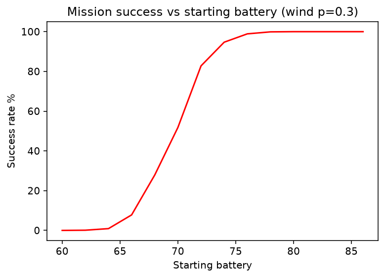

# Delivery Drone

A Python simulation of a delivery drone on a grid map. The drone takes off from a start point carrying three packages, plans a route around walls to each delivery point, delivers them nearest-first, and has to finish before its battery runs out. The project then estimates how often a mission succeeds when random wind drains extra battery.

## The map

The map is read from `map.txt`:

```
##########
#S...#...#
#.##.#.#.#
#.#..#.#A#
#.#.##.#.#
#...B..#.#
###.####.#
#C.......#
##########
```

`#` is a wall, `.` is free space, `S` is the start, and `A`, `B`, `C` are delivery points. Positions are written as `[row, column]`, counted from the top-left corner.

## How a mission works

```
load_map → distances → delivery_order → fly_mission
                                          for each delivery:
                                            find_path → check_path → fly → deliver
```

1. **Load the map** (`load_map`): reads `map.txt` into a grid of characters and a dictionary of the special cells.
2. **Measure distances** (`distances`): finds a route from `S` to every delivery point and counts its moves.
3. **Choose the order** (`delivery_order`): sorts the deliveries nearest-first with a randomized quicksort.
4. **Load the drone**: packages are a stack (last in, first out), so they are loaded in reverse delivery order.
5. **Fly the mission** (`fly_mission`): for each delivery, plan a route from the drone's current position, validate it, fly it cell by cell, and drop the package.

## Components

| Part | What it does |
|---|---|
| `Drone` | Position, battery and flight log. Moves one cell at a time (up, down, left, right) and spends battery on every move. |
| `CargoDrone(Drone)` | Adds a stack of packages. A move costs 2 battery units while carrying 2 or more packages, otherwise 1. |
| `WindyCargoDrone(CargoDrone)` | Adds wind: after each move, with probability `p`, a gust costs 1 extra battery unit. |
| `find_path` | Recursive depth-first search that returns a route as a list of cells, or `None` if the target is unreachable. |
| `check_path` | Validates a route: correct start and end, no walls, and every step between neighbouring cells. |
| `distances`, `delivery_order` | Plan the order of deliveries. |
| `fly_mission` | Runs a full mission and returns `True` if every package was delivered. |
| `monteCarloplotting` | Runs 1000 windy missions per starting battery level and plots the success rate. |

## Results

**Without wind**, the mission needs exactly **60 battery units**. With 59, the drone runs out one cell before its last delivery.

**With wind** (a 30% chance of a gust on every move), the required battery is no longer fixed, so the success rate is estimated with Monte Carlo simulation: 1000 missions for each starting battery from 60 to 86.



The success rate stays near 0% up to about 64 units, crosses 50% around 70, and rises above 95% from about 76. The 50% point matches a quick estimate: the mission has 35 moves, so about 0.3 × 35 ≈ 10.5 extra units are expected on top of the 60 needed without wind.

## Model assumptions

- The drone moves on a grid, one cell per move, in four directions only.
- Battery is measured in units: 1 per move, or 2 per move while carrying 2 or more packages.
- A move is allowed whenever the battery is above 0, and the battery never goes below 0.
- Wind only costs energy. A gust never pushes the drone off its route.
- The map has a complete wall border.
- The depth-first search returns *a* route, not necessarily the shortest one.

## How to run

Requirements: Python 3 and `matplotlib`.

```
python drone.py
```

`map.txt` must be in the same folder. Running the file executes the tests for every stage, prints their results, and shows the success-rate plot.

## Files

| File | Contents |
|---|---|
| `drone.py` | All classes, functions and tests |
| `map.txt` | The map |
| `successrateplot.png` | The Monte Carlo plot |
